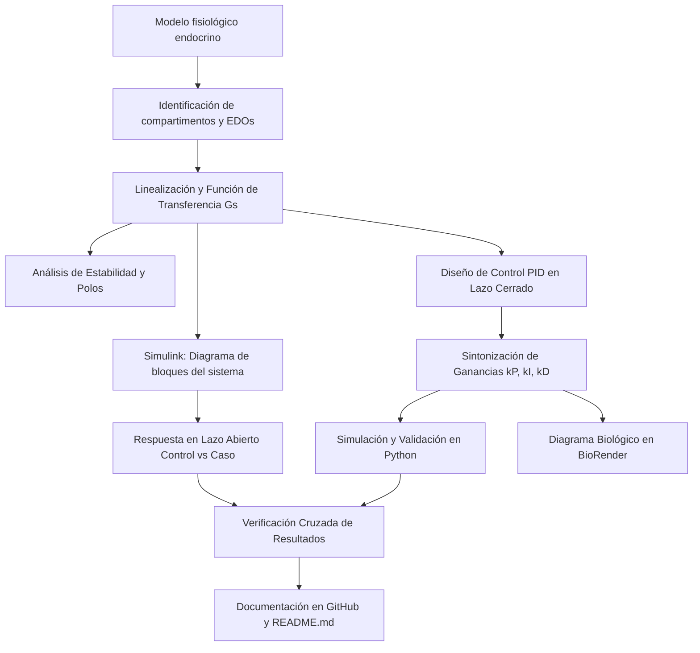

[](https://matlab.mathworks.com/open/github/v1?repo=l23212179-NAA/MSFP4)

# Práctica 4: Modelado y control del sistema endocrino

Repositorio académico de la asignatura **Modelado de Sistemas Fisiológicos**, correspondiente al programa de **Ingeniería Biomédica** del Tecnológico Nacional de México / Instituto Tecnológico de Tijuana. Esta práctica integra el modelado dinámico de la regulación hormonal y metabólica (sistema endocrino), su representación mediante ecuaciones diferenciales y diagramas de bloques, análisis temporal y de estabilidad, diseño de controladores PID para regulación glucémica u hormonal, simulación computacional *in silico* y verificación cruzada entre múltiples plataformas.

El caso de estudio analiza la regulación de la glucosa en sangre y la secreción de insulina (u otra dinámica hormonal homóloga), evaluando el comportamiento de un **individuo sano (control)** frente a una **condición patológica simulada (caso, p. ej., resistencia a la insulina o disfunción endocrina)**, tanto en lazo abierto como en lazo cerrado mediante un controlador PID.

**Docente:** Dr. Paul Antonio Valle Trujillo  
**Correo:** paul.valle@tectijuana.edu.mx  
**Departamento:** Ingeniería Eléctrica y Electrónica  
**Institución:** Tecnológico Nacional de México / Instituto Tecnológico de Tijuana  
**Asignatura:** Modelado de Sistemas Fisiológicos  
**Programa:** Ingeniería Biomédica  
**Estudiante:** Nicole Arredondo Arevalo · 23212179 · L23212179@tijuana.tecnm.mx  

**Repositorio de la asignatura:** https://github.com/DrPaulValle/MSF-IBF1020  
**Sede:** Blvd. Alberto Limón Padilla s/n, Tijuana, C. P. 22454, B. C., México.

---

<a id="contenido"></a>
## Contenido

1. [Resumen](#resumen)
2. [Competencia y objetivos](#objetivos)
3. [Relación con el temario](#temario)
4. [Modelo fisiológico y ecuaciones del sistema](#modelo-fisiologico)
5. [Formulación matemática y función de transferencia](#modelo)
6. [Análisis temporal y de estabilidad](#analisis)
7. [Señales de entrada y condiciones de simulación](#senales)
8. [Implementación en MATLAB, Simulink y Simscape](#matlab)
9. [Control en lazo cerrado y sintonización PID](#pid)
10. [Reproducción en Python](#python)
11. [Verificación entre representaciones](#verificacion)
12. [Resultados y verificación cruzada](#resultados)
13. [Flujo de trabajo](#flujo)
14. [Actividades del estudiante](#actividades)
15. [Estructura del repositorio](#estructura)
16. [Requisitos](#requisitos)
17. [Reproducibilidad y entregables](#reproducibilidad)
18. [Referencias](#referencias)

---

<a id="resumen"></a>
## Resumen

La práctica tiene como propósito **desarrollar un procedimiento completo de modelado, análisis, simulación y control *in silico*** para el sistema endocrino. Las interacciones hormonales y metabólicas se representan mediante ecuaciones diferenciales ordinarias (EDO) que describen la cinética de producción, distribución y eliminación de hormonas o metabolitos clave en el organismo.

A través de la teoría de sistemas dinámicos y control clásico, se estudia el comportamiento homeostático comparando un sujeto sano frente a una patología endocrina representada por alteraciones en los parámetros cinéticos o de retroalimentación. Se incorpora un **controlador PID con retroalimentación negativa** que simula una intervención terapéutica o de soporte artificial para corregir la respuesta del sujeto con alteración endocrina. Los resultados se validan mediante MATLAB, Simulink y Python.

**Palabras clave:** sistema endocrino; regulación hormonal; homeostasis de glucosa; controlador PID; modelado de sistemas fisiológicos; MATLAB; Simulink; Python; simulación *in silico*.

[Volver al contenido](#contenido)

---

<a id="objetivos"></a>
## Competencia y objetivos

### Competencia a desarrollar

Modelizar sistemas fisiológicos de regulación hormonal y metabólica mediante ecuaciones diferenciales, funciones de transferencia y diagramas de bloques para analizar su estabilidad homeostática y diseñar estrategias de control clásico orientadas al restablecimiento del equilibrio dinámico.

### Objetivo general

Modelar, analizar y simular la respuesta dinámica del sistema endocrino ante perturbaciones o entradas de carga mediante su formulación matemática y control por retroalimentación negativa, comparando la respuesta temporal de la condición de referencia (sano) y el caso patológico.

### Objetivos específicos

- Identificar los compartimentos fisiológicos, las variables de concentración hormonal/metabólica y los mecanismos de retroalimentación (feedback positivo o negativo).
- Derivar las ecuaciones diferenciales y la función de transferencia $G(s)$ del sistema endocrino para los casos de referencia y patológico.
- Analizar la estabilidad y localización de polos en el plano complejo para evaluar la capacidad homeostática del sistema.
- Simular la respuesta dinámica ante una carga o ingesta en MATLAB, Simulink y Python.
- Diseñar y sintonizar un controlador PID para regular la concentración y minimizar el error de seguimiento frente a la condición sana.
- Validar y verificar cruzadamente las respuestas computacionales obtenidas en las diferentes plataformas.
- Elaborar un diagrama biológico en BioRender que ilustre la interacción entre los órganos glandulares, las hormonas liberadas y los tejidos blanco.

[Volver al contenido](#contenido)

---

<a id="temario"></a>
## Relación con el temario

La práctica integra contenidos correspondientes a las tres unidades principales de la asignatura **Modelado de Sistemas Fisiológicos (IBF-1020)**:

| Unidad | Área | Contenidos aplicados |
|---|---|---|
| I | Sistemas de control retroalimentados | Diagramas de bloques homeostáticos, respuesta ante perturbaciones, análisis de error y criterios de estabilidad en el plano complejo. |
| II | Modelado matemático | Linealización de modelos no lineales, ecuaciones diferenciales del sistema endocrino y obtención de funciones de transferencia. |
| III | Controladores | Configuración del controlador PID, sintonización de ganancias $k_P, k_I, k_D$ y retroalimentación negativa para regulación fisiológica. |

[Volver al contenido](#contenido)

---

<a id="modelo-fisiologico"></a>
## Modelo fisiológico y ecuaciones del sistema

### Descripción del modelo endocrino

El sistema se aproxima mediante un modelo compartimental (como el modelo mínimo de Bergman para la glucosa e insulina, u otro sistema endocrino análogo de retroalimentación hormonal), considerando:
- $G(t)$: Concentración de glucosa o metabolito regulado en sangre.
- $I(t)$: Concentración de insulina u hormona reguladora activa.
- Parámetros cinéticos de secreción, sensibilidad tisular, tasa de eliminación y volumen de distribución.

### Parámetros de simulación

| Parámetro | Unidades | Condición Control (Sano) | Condición Caso (Patológico) |
|---|---|---|---|
| Entrada de perturbación | $\mathrm{mg/dL}$ o $\mu\mathrm{U/mL}$ | Escalón / Impulso estándar | Escalón / Impulso estándar |
| Sensibilidad / Cinética $K$ | Adimensional / Variable | Valor nominal de referencia | Valor disminuido / alterado |
| Constante de tiempo $\tau$ | Minutos / Segundos | Dinámica compensada | Dinámica lenta / deficiente |

[Volver al contenido](#contenido)

---

<a id="modelo"></a>
## Formulación matemática

### 1. Ecuaciones integro-diferenciales

Aplicando las leyes de Kirchhoff al circuito eléctrico equivalente del sistema endócrino, se establece la relación entre la corriente de entrada $F_e(t)$, la corriente del capacitor $F_c(t)$ y la corriente de la rama de salida $F_s(t)$:

$$F_e(t)=F_c(t)+F_s(t)$$

La corriente del capacitor está dada por:

$$F_c(t)=C\frac{dV_s(t)}{dt}$$

Para la resistencia de entrada:

$$V_e(t)=R_1F_e(t)+V_s(t)$$

Y para la rama formada por la inductancia $L$ y la resistencia $R_2$:

$$V_s(t)=L\frac{dF_s(t)}{dt}+R_2F_s(t)$$

Por lo tanto, el modelo se expresa mediante:

$$\boxed{\frac{V_e(t)-V_s(t)}{R_1} = C\frac{dV_s(t)}{dt}+F_s(t)}$$

$$\boxed{L\frac{dF_s(t)}{dt} = V_s(t)-R_2F_s(t)}$$

### 2. Función de transferencia

Aplicando la transformada de Laplace con condiciones iniciales nulas:

$$\frac{V_e(s)-V_s(s)}{R_1} = CsV_s(s)+F_s(s)$$

De la rama inductiva:

$$F_s(s)=\frac{V_s(s)}{Ls+R_2}$$

Sustituyendo y agrupando términos:

$$[V_e(s)-V_s(s)](Ls+R_2) = R_1CsV_s(s)(Ls+R_2)+R_1V_s(s)$$

Desarrollando la expresión:

$$V_e(s)(Ls+R_2) = V_s(s)\left[R_1LCs^2+(L+R_1R_2C)s+(R_1+R_2)\right]$$

Por lo tanto, la función de transferencia del sistema endócrino está dada por:

$$\boxed{G(s)=\frac{V_s(s)}{V_e(s)} = \frac{Ls+R_2}{R_1LCs^2+(L+R_1R_2C)s+(R_1+R_2)}}$$

El denominador es de segundo grado debido a la presencia de dos elementos independientes de almacenamiento de energía: la capacitancia $C$ y la inductancia $L$.

### 3. Funciones de transferencia del control y del caso

*Condición de referencia (control)*

Considerando los parámetros $R_1=1000\ \Omega$, $L=0.1\ \mathrm{H}$, $C=10^{-6}\ \mathrm{F}$ y $R_2=100000\ \Omega$:

$$G_{\mathrm{control}}(s) = \frac{0.1s+100000}{0.0001s^2+100.1s+101000}$$

*Condición alterada (caso)*

Considerando $R_1=1000\ \Omega$, $L=0.1\ \mathrm{H}$, $C=10^{-3}\ \mathrm{F}$ y $R_2=1000\ \Omega$:

$$G_{\mathrm{caso}}(s) = \frac{0.1s+1000}{0.1s^2+1000.1s+2000}$$

La modificación simultánea de la capacitancia $C$ y la resistencia $R_2$ produce diferencias en la ganancia estática, la posición de los polos y la respuesta temporal de ambos modelos.

### 4. Representación mediante ecuaciones diferenciales de primer orden

Definiendo las variables de estado $x_1(t)=V_s(t)$ y $x_2(t)=F_s(t)$, el modelo puede expresarse mediante dos ecuaciones diferenciales ordinarias.

A partir de la ley de corrientes de Kirchhoff:

$$\frac{V_e(t)-V_s(t)}{R_1} = C\frac{dV_s(t)}{dt}+F_s(t)$$

Despejando la derivada de la primera variable de estado:

$$\boxed{\frac{dx_1(t)}{dt} = \frac{V_e(t)-x_1(t)}{R_1C} - \frac{x_2(t)}{C}}$$

Para la rama formada por $L$ y $R_2$:

$$V_s(t)=L\frac{dF_s(t)}{dt}+R_2F_s(t)$$

Despejando la derivada de la segunda variable:

$$\boxed{\frac{dx_2(t)}{dt} = \frac{x_1(t)-R_2x_2(t)}{L}}$$

La variable de salida corresponde al voltaje del nodo:

$$V_s(t)=x_1(t)$$

Esta representación permite implementar el modelo mediante bloques de integración en Simulink y verificar su equivalencia con la función de transferencia y el circuito eléctrico equivalente construido en Simscape Electrical.

[Volver al contenido](#contenido)

---

<a id="analisis"></a>
## Análisis temporal y de estabilidad

### 1. Regulación y error en estado estacionario

Se evalúa la capacidad del sistema para retornar a los valores basales (homeostasis) tras una perturbación, analizando el error en estado estacionario ante entradas tipo escalón.

### 2. Polos y estabilidad

Se calculan las raíces del denominador de la función de transferencia $G(s)$:
- Se analiza la ubicación de los polos en el semiplano izquierdo para confirmar la estabilidad asintótica.
- Se compara el cambio en la amortiguación y velocidad de establecimiento entre el sujeto sano y el caso patológico.

[Volver al contenido](#contenido)

---

<a id="senales"></a>
## Señales de entrada y condiciones de simulación

El intervalo nominal de simulación se establece en función de la dinámica temporal del sistema endocrino (p. ej., $0 \le t \le 120\,\mathrm{min}$ o $0 \le t \le 10\,\mathrm{s}$ según la normalización del modelo).

| Señal | Definición computacional | Propósito |
|---|---|---|
| Entrada tipo escalón / pulso | Variación abrupta en la concentración de entrada | Evaluar la respuesta transitoria, sobreimpulso y tiempo de establecimiento homeostático |

[Volver al contenido](#contenido)

---

<a id="matlab"></a>
## Implementación en MATLAB, Simulink y Simscape

Se evalúan las representaciones computacionales para ambas condiciones:

| Implementación | Descripción | Aspecto a verificar |
|---|---|---|
| Ecuaciones diferenciales | Diagrama de bloques en Simulink basado en EDOs acopladas | Correcta simulación de la interacción no lineal o linealizada |
| Función de transferencia | Bloque `Transfer Fcn` con $G(s)$ | Respuesta dinámica entrada-salida del sistema endocrino |

[Volver al contenido](#contenido)

---

<a id="pid"></a>
## Control en lazo cerrado y sintonización PID

### 1. Esquema de retroalimentación

Se utiliza la respuesta del individuo sano como señal de referencia de control homeostático. La señal de error está dada por:

$$e(t) = y_{\text{control}}(t) - y_{\text{caso}}(t)$$

El controlador PID genera la acción correctiva para compensar la disfunción endocrina del modelo patológico.

### 2. Sintonización

Mediante la herramienta **Tune** del bloque `PID Controller` en Simulink, se determinan las ganancias óptimas $k_P$, $k_I$ y $k_D$ para lograr una recuperación estable y sin oscilaciones excesivas.

[Volver al contenido](#contenido)

---

<a id="python"></a>
## Reproducción en Python

A través de **Visual Studio Code** y la biblioteca `scipy.signal` / `control`, se implementan los scripts en Python para:
1. Definir las funciones de transferencia del sistema endocrino para control y caso.
2. Simular la respuesta temporal en lazo abierto.
3. Implementar el lazo cerrado con el controlador PID sintonizado.
4. Exportar las gráficas comparativas en formato PDF.

[Volver al contenido](#contenido)

---

<a id="verificacion"></a>
## Verificación entre representaciones

Se contrastan los resultados numéricos obtenidos en:
- Diagramas de bloques en Simulink
- Funciones de transferencia
- Cuaderno computacional de MATLAB (`.mlx`)
- Script ejecutable en Python (`.py`)

Asegurando la congruencia analítica entre todas las plataformas.

[Volver al contenido](#contenido)

---

<a id="resultados"></a>
## Resultados y verificación cruzada

Convención gráfica de colores utilizada:
- **Línea Amarilla:** Señal de referencia / Entrada aplicada.
- **Línea Azul:** Respuesta del sistema en lazo abierto (Sujeto Sano - Control).
- **Línea Roja / Guiones:** Respuesta del sistema en lazo abierto (Condición Patológica - Caso).
- **Línea Verde:** Respuesta en lazo cerrado con controlador PID.

[Volver al contenido](#contenido)

---

<a id="flujo"></a>
## Flujo de trabajo


[Volver al contenido](#contenido)

---

<a id="actividades"></a>
## Actividades del estudiante

- [ ] **Etapa 1:** Investigar y analizar el modelo fisiológico del sistema endocrino asignado (cinética hormonal / glucosa).
- [ ] **Etapa 2:** Derivar las ecuaciones diferenciales y obtener la función de transferencia $G(s)$ para Control y Caso.
- [ ] **Etapa 3:** Analizar la estabilidad y la ubicación de los polos en el plano complejo.
- [ ] **Etapa 4:** Implementar el modelo computacional en Simulink.
- [ ] **Etapa 5:** Diseñar y sintonizar el controlador PID en lazo cerrado para regulación.
- [ ] **Etapa 6:** Reproducir la simulación mediante script en Python en Visual Studio Code.
- [ ] **Etapa 7:** Elaborar el esquema biológico-funcional en BioRender.
- [ ] **Etapa 8:** Integrar la documentación, subir código al repositorio de GitHub y actualizar el archivo `CITATION.cff`.

[Volver al contenido](#contenido)

---

<a id="estructura"></a>
## Estructura del repositorio

```text
.
├── Análisis_4.pdf                 # Análisis matemático de la practica
├── README.md                      # Reporte de la práctica y guía de reproducción
├── CITATION.cff                   # Archivo de citación académica
├── Arredondo23212179.mlx         # Cuaderno de MATLAB del estudiante
├── Arredondo23212179.pdf         # Exportación del cuaderno de MATLAB
├── sistema4.slx                  # Modelo de Simulink de la práctica 
├── Arredondo23212179.py           # Script de simulación en Python
├── BioRender4.png                 # Ilustración de la práctica en BioRender
└── evidencias/                   # Gráficas en formato PDF/PNG/BMP y capturas
```
[Volver al contenido](#contenido)

<a id="requisitos"></a>
## Requisitos

### Software
- **MATLAB** (con Simulink y Control System Toolbox).
- **Python 3.x** con entornos **Visual Studio Code**.
- Bibliotecas de Python: `numpy`, `scipy`, `matplotlib`, `control`.
- **BioRender** (o herramienta equivalente) para diagramas biológicos.
- **Git** y **GitHub** para control de versiones y publicación.

[Volver al contenido](#contenido)

---

<a id="reproducibilidad"></a>
## Reproducibilidad y entregables

### Resultados mínimos esperados

| Entregable | Contenido requerido |
|---|---|
| **Matemático** | Ecuaciones diferenciales, función de transferencia $G(s)$ y análisis de polos. |
| **Simulink** | Modelo `.slx` con simulación en lazo abierto y cerrado. |
| **Control PID** | Ganancias sintonizadas ($k_P, k_I, k_D$) y gráfica de regulación. |
| **Python** | Código `.py` ejecutable y gráficos exportados en PDF. |
| **Diagrama** | Esquema biológico del eje endocrino exportado desde BioRender. |
| **Repositorio** | `README.md`, `CITATION.cff`, código fuente y evidencias organizados. |

[Volver al contenido](#contenido)

---

<a id="referencias"></a>
## Referencias

[1] M. C. Khoo, *Physiological Control Systems: Analysis, Simulation, and Estimation*, 2nd ed., IEEE Press, 2018.  
[2] F. C. Hoppensteadt y C. S. Peskin, *Modeling and Simulation in Medicine and the Life Sciences*, Springer.  
[3] J. E. Hall, *Guyton and Hall Textbook of Medical Physiology*, 14th ed., Elsevier, 2021.  
[4] K. Ogata, *Ingeniería de Control Moderna*, 5.ª ed., Pearson Educación, 2010.  
[5] N. S. Nise, *Control Systems Engineering*, 8th ed., John Wiley & Sons, 2020.  
[6] P. A. Valle, *Syllabus para Modelado de Sistemas Fisiológicos*, Tecnológico Nacional de México / Instituto Tecnológico de Tijuana, Tijuana, B. C., México, 2026.  
[7] Tecnológico Nacional de México, *Programa de estudio de la asignatura Modelado de Sistemas Fisiológicos, IBF-1020*.  

---

## Uso académico

Este repositorio es una evidencia académica desarrollada para la asignatura **Modelado de Sistemas Fisiológicos**. Los modelos y simulaciones son de carácter didáctico *in silico* y no deben ser utilizados como recomendaciones o protocolos de diagnóstico o tratamiento médico real.
